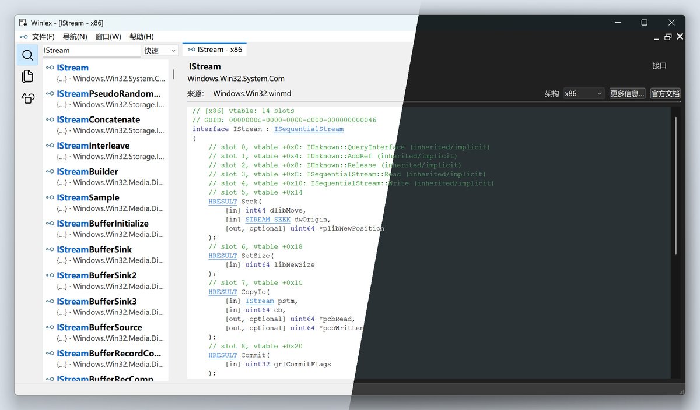
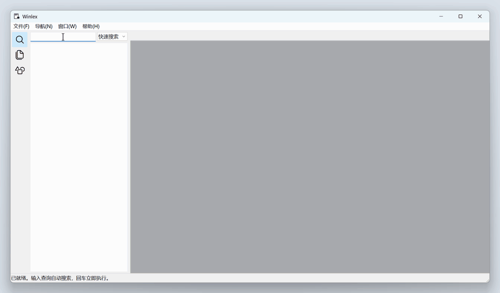

# Winlex

离线 Windows API 参考查询工具，直接读取本地 WinMD，提供原生 Windows 界面与命令行。



- **搜索 API**：按名称、常量值、GUID 快速查找，或组合条件精确筛选。
- **阅读声明**：查看参数、类型与反向引用，跨 WinMD 解析 Win32、WDK 和 WinRT 等元数据。
- **比较布局**：按 x86、x64、ARM64 ABI 查看字段偏移、结构大小、位域与 COM vtable 槽位。
- **查询错误码**：独立查询 Win32、HRESULT、NTSTATUS 和自定义模块消息，无需加载 WinMD。

提供 Windows x86、x64 和 ARM64 构建，各架构的系统基线见[构建与验证](docs/build.md)。

## 开始使用

从 [Winlex Releases](https://github.com/killtimer0/winlex/releases) 下载程序，从 [winmd-collection Releases](https://github.com/killtimer0/winmd-collection/releases) 获取 WinMD。

### 图形界面

启动 `winlex-gui.exe`，通过“打开文件”（Ctrl+O）或拖放加载 WinMD。输入查询后自动搜索，单击结果预览声明，双击或 Enter 固定文档。



Ctrl+Enter 可打开文档副本，便于并排比较。界面支持中英文、浅色／深色主题、DPI 缩放和高对比度，详细操作见 [GUI 使用指南](docs/gui.md)。

### 命令行

在查询命令前指定本地输入文件，支持文本和 JSON 输出：

```powershell
winlex Windows.Win32.winmd search CreateFileW --name
winlex Windows.Win32.winmd layout OVERLAPPED --arch x64
winlex Windows.Win32.winmd vtable IStream --arch x64 --json
```

查询架构与程序自身架构无关。命令、输出及限制见 [CLI 文档](docs/cli.md)。

## 许可证

Winlex 采用 [GNU GPL v3.0](LICENSE)（`GPL-3.0-only`）许可证。第三方组件保留各自的许可证。

## 开发

使用 Rust MSVC 工具链。准备链接依赖，并按[构建指南](docs/build.md)放置测试元数据后运行核心测试：

```powershell
python scripts/prepare-inputs.py
cargo test -p winlex-core -p winlex-format -p winlex-cli --locked
```

构建步骤和测试指南见 [构建与验证](docs/build.md)。
